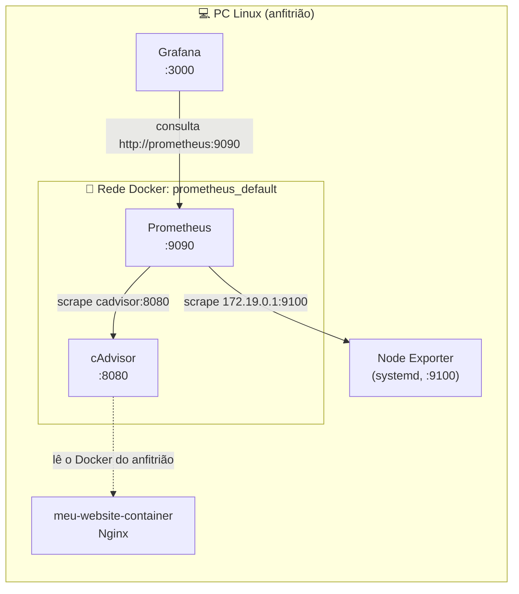

# 📊 Monitorização com Prometheus + Grafana (Docker)

Monitorização de um PC Linux e dos seus contentores Docker com **Prometheus** e **Grafana**. O **Node Exporter** mede o sistema e o **cAdvisor** mede os contentores, incluindo o contentor de um website Nginx.

## 📌 Índice

1. [O que foi feito](#-o-que-foi-feito)
2. [Arquitetura](#️-arquitetura)
3. [Implementação passo a passo](#-implementação-passo-a-passo)
4. [Monitorizar o contentor do website](#-monitorizar-o-contentor-do-website)
5. [Problemas encontrados e soluções](#-problemas-encontrados-e-soluções)
6. [Estrutura de ficheiros](#-estrutura-de-ficheiros)

---

## ✅ O que foi feito

- Instalação do **Node Exporter** no PC (nativo, com serviço systemd)
- **Prometheus** e **cAdvisor** em Docker
- **Grafana** em Docker, ligado ao Prometheus
- Dashboard do Node Exporter (ID 1860) no Grafana
- Monitorização do contentor do website Nginx através do cAdvisor

---

## 🏛️ Arquitetura



O Prometheus corre dentro de um contentor, por isso `localhost` para ele é o próprio contentor. O Node Exporter corre no anfitrião e é alcançado pelo gateway da rede Docker (`172.19.0.1`). O cAdvisor está na mesma rede que o Prometheus e é encontrado pelo nome.

---
## 📁 Estrutura de ficheiros

```
docker compose/
├── prometheus/
│   ├── docker-compose.yml        ← Prometheus + cAdvisor
│   └── prometheus.yml
├── grafana/
    └── docker-compose.yml        ← Grafana

```


## 🚀 Implementação passo a passo

### 1. Instalar o Node Exporter (nativo)

```bash
wget https://github.com/prometheus/node_exporter/releases/download/v<VERSAO>/node_exporter-<VERSAO>.linux-amd64.tar.gz
tar xvf node_exporter-<VERSAO>.linux-amd64.tar.gz
cd node_exporter-<VERSAO>.linux-amd64

sudo cp node_exporter /usr/local/bin

sudo useradd --no-create-home --shell /bin/false node_exporter
sudo chown node_exporter:node_exporter /usr/local/bin/node_exporter

sudo nano /etc/systemd/system/node_exporter.service
```

Conteudo do serviço node_exporter (`/etc/systemd/system/node_exporter.service`):

```ini
[Unit]
Description=Node Exporter
Wants=network-online.target
After=network-online.target

[Service]
User=node_exporter
Group=node_exporter
Type=simple
ExecStart=/usr/local/bin/node_exporter
Restart=always
RestartSec=3

[Install]
WantedBy=multi-user.target
```

```bash
sudo systemctl daemon-reload
sudo systemctl enable node_exporter
sudo systemctl start node_exporter
sudo systemctl status node_exporter
```

Verificação:

```bash
curl -s localhost:9100/metrics | head -5
```

### 2. Prometheus e cAdvisor (Docker)

`prometheus/prometheus.yml`:

```yaml
global:
  scrape_interval: 15s
  scrape_timeout: 10s
  evaluation_interval: 15s
alerting:
  alertmanagers:
    - static_configs:
      - targets: []
      scheme: http
      timeout: 10s
      api_version: v2
scrape_configs:
  - job_name: prometheus
    honor_timestamps: true
    scrape_interval: 15s
    scrape_timeout: 10s
    metrics_path: /metrics
    scheme: http
    static_configs:
      - targets:
        - localhost:9090
  - job_name: node_exporter # Change to whatever you like
    static_configs:
      - targets: ['172.19.0.1:9100'] #Change this to your server's IP
  
  - job_name: cadvisor
    static_configs:
      - targets: ['cadvisor:8080']
```

`prometheus/docker-compose.yml`:

```yaml
services:
  prometheus:
    image: prom/prometheus
    container_name: prometheus
    command:
      - '--config.file=/etc/prometheus/prometheus.yml'
    ports:
      - 9090:9090
    restart: unless-stopped
    volumes:
      - ./prometheus:/etc/prometheus
      - prom_data:/prometheus


## cAdvisor - service to monitor Docker containers      
  cadvisor:
    image: gcr.io/cadvisor/cadvisor:latest
    container_name: cadvisor
    restart: unless-stopped
    privileged: true
    devices:
      - /dev/kmsg
    volumes:
      - /:/rootfs:ro
      - /var/run:/var/run:ro
      - /sys:/sys:ro
      - /var/lib/docker/:/var/lib/docker:ro
      - /dev/disk/:/dev/disk:ro
    ports:
      - "8080:8080"

volumes:
  prom_data:
```

```bash
docker compose up -d
docker restart prometheus
```

Verificação: `http://localhost:9090/targets` com todos os jobs em **UP**.

### 3. Grafana (Docker)

`grafana/docker-compose.yml`:

```yaml
version: "3.8"
services:
  grafana:
    image: grafana/grafana
    container_name: grafana
    restart: unless-stopped
    ports:
     - '3000:3000'
    volumes:
      - grafana-storage:/var/lib/grafana
volumes:
  grafana-storage: {}

```

Acesso em `http://localhost:3000`.

### 4. Pôr o Grafana na rede do Prometheus

```bash
docker network connect prometheus_default grafana
docker exec grafana wget -qO- http://prometheus:9090/-/ready
```

### 5. Data source no Grafana

**Connections → Data sources → Add data source → Prometheus**

| Campo | Valor |
|---|---|
| URL | `http://prometheus:9090` |

**Save & test**.

### 6. Dashboard do Node Exporter

**Dashboards → New → Import** → ID `1860` (Node Exporter Full) → data source `prometheus`.

---

## 🌐 Monitorizar o contentor do website

O website corre num contentor Nginx:

```bash
docker run -d -p 8081:80 --name meu-website-container meu-website:v1.0
```

O cAdvisor lê o Docker do anfitrião e vê o contentor sem ser preciso alterar a imagem. As métricas consultaram-se no Grafana (Explore → modo **Code**):

| Query | Mostra |
|---|---|
| `container_memory_usage_bytes{name="meu-website-container"}` | Memória usada pelo contentor |
| `rate(container_cpu_usage_seconds_total{name="meu-website-container"}[1m])` | CPU (1 = um core inteiro) |
| `rate(container_network_receive_bytes_total{name="meu-website-container"}[1m])` | Tráfego recebido |
| `rate(container_network_transmit_bytes_total{name="meu-website-container"}[1m])` | Tráfego enviado |

---

## 🐞 Problemas encontrados e soluções

| # | Erro | Causa | Solução |
|---|---|---|---|
| 1 | Grafana: `lookup prometheus on 127.0.0.11:53: server misbehaving` | Grafana e Prometheus subiram de pastas diferentes, cada um na sua rede (`grafana_default` e `prometheus_default`); o DNS interno do Docker só resolve nomes dentro da mesma rede | `docker network connect prometheus_default grafana` |
| 2 | Prometheus: `dial tcp [::1]:9100: connection refused` no job `node_exporter` | O alvo era `localhost:9100`, mas dentro do contentor `localhost` é o próprio Prometheus, e o Node Exporter corre no anfitrião | Alvo alterado para o gateway da rede: `172.19.0.1:9100` ||
| 3 | Dashboard 1860 com o seletor **Job** vazio e painéis a `N/A`, apesar de o Explore mostrar dados | O dashboard foi importado quando o alvo ainda estava DOWN, e a variável `job` ficou guardada vazia | Criado um dashboard novo, em que o Job apareceu logo |
| 4 | Prometheus: `localhost:8080 ... connection refused` no job `cadvisor` | Mesmo erro do problema 2, aplicado ao cAdvisor | Alvo alterado para `cadvisor:8080` |
| 5 | Prometheus: `lookup cadvisor ... server misbehaving` | Mesma causa do problema 1: o cAdvisor não estava na mesma rede que o Prometheus | cAdvisor ligado à rede do Prometheus |


