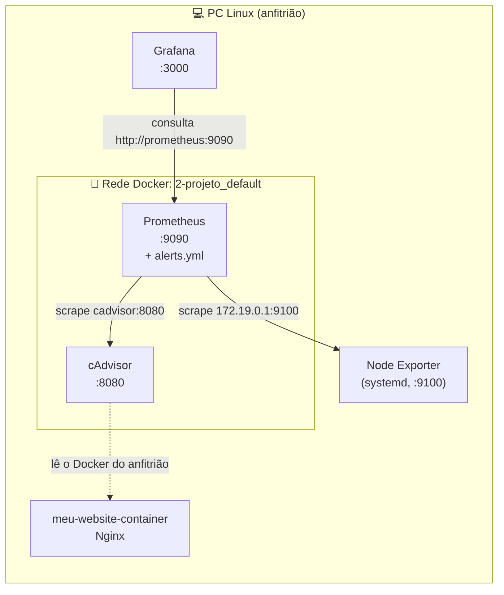

# 🚨 Alertas com Prometheus + Grafana (Fase 2)

Continuação do projeto de monitorização. A infraestrutura da Fase 1 (Prometheus, cAdvisor, Node Exporter e Grafana) mantém-se igual, e nesta fase são criadas **regras de alerta** para o CPU do PC (Node Exporter) e para o estado do contentor do website (cAdvisor).

## 📌 Índice

1. [O que foi feito](#-o-que-foi-feito)
2. [Alertas criados](#-alertas-criados)
3. [Arquitetura](#️-arquitetura)
4. [Implementação passo a passo](#-implementação-passo-a-passo)
5. [Simular os alertas](#-simular-os-alertas)
6. [Problemas encontrados e soluções](#-problemas-encontrados-e-soluções)
7. [Estrutura de ficheiros](#-estrutura-de-ficheiros)

---

## ✅ O que foi feito

- `docker-compose.yml` **sem alterações**
- `prometheus.yml`: acrescentado o bloco `rule_files`, que indica ao Prometheus onde estão as regras
- Criado o ficheiro `alerts.yml` com três regras de alerta
- Validação das regras com o `promtool`
- Grafana ligado à rede do novo Prometheus
- Simulação dos três alertas (CPU alto, contentor parado e contentor reiniciado)

---

## 🚨 Alertas criados

| Alerta | Condição | Espera (`for`) | Severidade |
|---|---|---|---|
| `CpuAlto` | CPU do PC acima de 70% (Node Exporter) | 2 minutos | warning |
| `WebsiteParado` | O cAdvisor deixa de ver o contentor `meu-website-container` (parado, apagado ou crashado) | 1 minuto | critical |
| `WebsiteReiniciou` | O contentor `meu-website-container` foi reiniciado nos últimos 5 minutos | nenhuma | warning |

### Estados de um alerta

| Estado | Significado |
|---|---|
| **Inactive** (verde) | A condição não está a ser cumprida |
| **Pending** (amarelo) | A condição está a ser cumprida, mas ainda não passou o tempo definido em `for` |
| **Firing** (vermelho) | A condição foi cumprida durante todo o `for`; o alerta está ativo |

---

## 🏛️ Arquitetura



O Prometheus avalia as regras de `alerts.yml` a cada `evaluation_interval` (15 segundos), usando as métricas que já recolhe do Node Exporter e do cAdvisor.

---
## 📁 Estrutura de ficheiros

```
2-Projeto/
├── docker-compose.yml        ← sem alterações
├── prometheus/
│   ├── prometheus.yml        ← acrescentado o rule_files
│   └── alerts.yml            ← novo: regras de alerta
├── Grafana/
│   └── docker-compose.yml
└── readme.md
```


## 🚀 Implementação passo a passo

### 1. Ponto de partida

O `docker-compose.yml` e os jobs do `prometheus.yml` (`prometheus`, `node_exporter` e `cadvisor`) ficaram como estavam. A pasta `./prometheus` está montada inteira em `/etc/prometheus`, por isso qualquer ficheiro novo criado lá dentro fica logo disponível no contentor.

### 2. Alteração ao `prometheus/prometheus.yml`

Foi acrescentado apenas este bloco, ao nível de `global` e `scrape_configs`:

```yaml
global:
  scrape_interval: 15s
  evaluation_interval: 15s

rule_files:
  - /etc/prometheus/alerts.yml

scrape_configs:
  # ... (jobs sem alterações)
```

O caminho é o **caminho dentro do contentor**: como `./prometheus` (no PC) é montado em `/etc/prometheus` (no contentor), o ficheiro `prometheus/alerts.yml` fica em `/etc/prometheus/alerts.yml`.

### 3. Criar `prometheus/alerts.yml`

```yaml
groups:
  - name: alertas-laboratorio
    rules:
      - alert: CpuAlto
        expr: 100 - (avg by (instance) (rate(node_cpu_seconds_total{mode="idle"}[2m])) * 100) > 70
        for: 2m
        labels:
          severity: warning
        annotations:
          summary: "CPU acima de 70% em {{ $labels.instance }}"
          description: "Utilização atual: {{ $value | printf \"%.1f\" }}%"

      - alert: WebsiteParado
        expr: absent(container_last_seen{name="meu-website-container"})
        for: 1m
        labels:
          severity: critical
        annotations:
          summary: "O contentor meu-website-container deixou de existir (parado ou crashado)"

      - alert: WebsiteReiniciou
        expr: changes(container_start_time_seconds{name="meu-website-container"}[5m]) > 0
        labels:
          severity: warning
        annotations:
          summary: "O contentor meu-website-container foi reiniciado"
```

#### Estrutura do ficheiro

| Elemento | O que faz |
|---|---|
| `groups` | Lista de grupos de regras. Um grupo reúne regras que são avaliadas em conjunto |
| `name` | Nome do grupo (aparece em `http://localhost:9090/alerts`) |
| `rules` | Lista das regras do grupo |
| `alert` | Nome do alerta |
| `expr` | Expressão em **PromQL** que define a condição. O alerta só existe enquanto a expressão devolver resultado |
| `for` | Tempo durante o qual a condição tem de se manter antes de o alerta passar de Pending a Firing. Evita alertas por picos momentâneos. Se for omitido, o alerta passa a Firing logo na primeira avaliação |
| `labels` | Etiquetas que acompanham o alerta (aqui, `severity`). São texto livre e não alteram o comportamento da regra |
| `annotations` | Texto descritivo do alerta, para um humano ler. Aceita variáveis |

#### Variáveis nas anotações

| Variável | Valor |
|---|---|
| `{{ $labels.instance }}` | O valor do label `instance` da série que disparou (aqui, `172.19.0.1:9100`) |
| `{{ $value }}` | O valor numérico da expressão no momento em que disparou |
| `printf "%.1f"` | Formata o número com uma casa decimal. As aspas ficam com `\"` porque estão dentro de um texto entre aspas |

#### Regra 1: `CpuAlto`

```
100 - (avg by (instance) (rate(node_cpu_seconds_total{mode="idle"}[2m])) * 100) > 70
```

A expressão lê-se de dentro para fora:

| Passo | Expressão | O que dá |
|---|---|---|
| 1 | `node_cpu_seconds_total{mode="idle"}` | Segundos acumulados que cada core passou **parado** (`idle`). É um counter: só sobe |
| 2 | `rate(...[2m])` | Quanto esse valor subiu por segundo, nos últimos 2 minutos. O resultado vai de 0 a 1 por core: 0.9 significa que o core esteve parado 90% do tempo |
| 3 | `avg by (instance) (...)` | Média de todos os cores, dando um único valor para o PC inteiro |
| 4 | `... * 100` | Converte para percentagem de tempo **parado** |
| 5 | `100 - (...)` | Inverte: percentagem de tempo **em uso** |
| 6 | `... > 70` | Só devolve resultado se o CPU em uso for superior a 70% |

Com `for: 2m`, o CPU tem de se manter acima de 70% durante 2 minutos seguidos para o alerta passar a Firing.

#### Regra 2: `WebsiteParado`

```
absent(container_last_seen{name="meu-website-container"})
```

| Parte | O que faz |
|---|---|
| `container_last_seen{name="meu-website-container"}` | Métrica do cAdvisor com a última vez que o contentor foi visto. Enquanto o contentor existe, a série existe |
| `absent(...)` | Devolve `1` quando a série **não existe**, e nada quando existe |

Ou seja: o alerta dispara quando o contentor desaparece do cAdvisor, seja por `docker stop`, por ser apagado ou por crashar. Com `for: 1m`, tem de estar ausente durante 1 minuto.

#### Regra 3: `WebsiteReiniciou`

```
changes(container_start_time_seconds{name="meu-website-container"}[5m]) > 0
```

| Parte | O que faz |
|---|---|
| `container_start_time_seconds{...}` | Métrica do cAdvisor com a hora a que o contentor arrancou. Só muda quando o contentor arranca de novo |
| `changes(...[5m])` | Conta quantas vezes o valor mudou nos últimos 5 minutos |
| `> 0` | Dispara se mudou pelo menos uma vez |

Não tem `for`, por isso passa a Firing logo na avaliação seguinte ao reinício, e mantém-se assim durante 5 minutos (a janela do `changes`). Cobre o caso em que o contentor reinicia tão depressa que o `WebsiteParado` não chega a disparar.

### 4. Validar e aplicar

```bash
docker exec prometheus promtool check rules /etc/prometheus/alerts.yml
docker restart prometheus
```

O `promtool` responde `SUCCESS: 3 rules found`.

Verificação:

- `http://localhost:9090/targets` — os três jobs em **UP**
- `http://localhost:9090/alerts` — as três regras em **Inactive**

### 5. Ligar o Grafana ao novo Prometheus

O Grafana já existente estava na rede `grafana_default`, e o novo Prometheus na `2-projeto_default`. Para os pôr na mesma rede:

```bash
docker network connect 2-projeto_default grafana
docker exec grafana wget -qO- http://prometheus:9090/-/ready
```

O segundo comando responde `Prometheus Server is Ready.`.

No Grafana, **Connections → Data sources → prometheus**, com o URL `http://prometheus:9090`, e **Save & test**. Os dashboards antigos passam a receber dados do novo Prometheus.

---

## 🧪 Simular os alertas

Os alertas veem-se em `http://localhost:9090/alerts`.

### CpuAlto

Um ciclo só carrega um core, por isso lança-se um por core:

```bash
docker run -d --name stress-cpu alpine sh -c 'for i in $(seq $(nproc)); do (while true; do :; done) & done; wait'
```

| Tempo | Estado |
|---|---|
| 15 a 30 segundos | Pending |
| 2 minutos | Firing |

Valor real do CPU (Grafana → Explore → modo **Code**):

```
100 - (avg by (instance) (rate(node_cpu_seconds_total{mode="idle"}[2m])) * 100)
```

Para terminar:

```bash
docker rm -f stress-cpu
```

### WebsiteParado

```bash
docker stop meu-website-container
```

Em 1 a 3 minutos o alerta passa a Pending e depois a Firing. Para resolver:

```bash
docker start meu-website-container
```

### WebsiteReiniciou

```bash
docker restart meu-website-container
```

O alerta passa a Firing logo no ciclo seguinte (até 15 segundos) e mantém-se durante 5 minutos, que é a janela do `changes(...[5m])`.

Para simular um crash:

```bash
docker kill meu-website-container
docker start meu-website-container
```

### Se um alerta não dispara

Corre a expressão no Explore e vê se devolve resultado:

| Alerta | Query para testar |
|---|---|
| WebsiteParado | `container_last_seen{name="meu-website-container"}` (com o contentor a correr deve devolver uma série) |
| WebsiteReiniciou | `container_start_time_seconds{name="meu-website-container"}` (o valor muda depois de um restart) |

---

## 🐞 Problemas encontrados e soluções

| # | Erro | Causa | Solução |
|---|---|---|---|
| 1 | `Conflict. The container name "/cadvisor" is already in use` | Os contentores do projeto anterior continuavam a existir, e o Docker não permite dois contentores com o mesmo nome | `docker rm -f cadvisor prometheus` e voltar a correr `docker compose up -d` |
| 2 | `error mounting ".../alerts.yml" to rootfs ... not a directory` | O compose tinha uma linha `./alerts.yml:/etc/prometheus/alerts.yml:ro`, mas o `alerts.yml` está dentro de `prometheus/`. Como `./alerts.yml` não existia na raiz, o Docker criou uma **pasta** com esse nome e falhou ao montá-la sobre um ficheiro | Apagar a linha do volume (a pasta `./prometheus` já é montada inteira) e remover a pasta falsa com `rmdir alerts.yml` |
| 3 | Prometheus: `cadvisor:8082 ... connection refused` | O alvo usava a porta do PC (`8082`), mas entre contentores usa-se a porta do contentor (`8080`) | Alvo alterado para `cadvisor:8080` |
| 4 | Dashboards do Grafana sem dados e com erros | O Grafana estava na rede `grafana_default` e o novo Prometheus na `2-projeto_default`, por isso o nome `prometheus` não resolvia | `docker network connect 2-projeto_default grafana` |

| Quem chama | Porta usada |
|---|---|
| Browser no PC (`localhost:8082`) | A do PC (a primeira do mapeamento) |
| Outro contentor da mesma rede (`cadvisor:8080`) | A do contentor (a segunda do mapeamento) |

---

